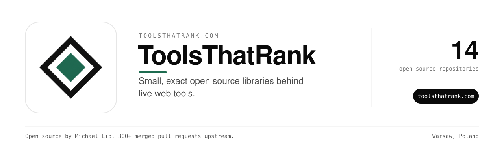

Every number on our sites comes from a formula you can read.
This organization holds those formulas. There are 17 small libraries in 9 languages. Each one does one calculation exactly and cites its source.

### Search and links

| Repository | Language | What it does |
| --- | --- | --- |
| [serp-ctr-rs](https://github.com/toolsthatrank/serp-ctr-rs) | Rust | CTR, weighted average position and click projection from Search Console data. |
| [followability-rs](https://github.com/handsofflinks/followability-rs) | Rust | Decides if a link is followed, from rel tokens, robots meta and X-Robots-Tag. |
| [link-followability](https://github.com/handsofflinks/link-followability) | Crystal | The same verdict as a Crystal shard. |
| [link-followability-php](https://github.com/handsofflinks/link-followability-php) | PHP | The same verdict for PHP. |
| [geo-citation-check](https://github.com/theluckystrike/geo-citation-check) | Go | Scores a page against eight AI citation readiness checks. |
| [rules_sitemap](https://github.com/toolsthatrank/rules_sitemap) | Starlark | Bazel rules that build sitemap.xml and robots.txt and fail on invalid output. |
| [niche-viability](https://github.com/aiwebsitepipeline/niche-viability) | Ruby | A six-factor score for whether a niche site is worth building. |

### Everyday calculators

| Repository | Language | Powers |
| --- | --- | --- |
| [comparative-fault](https://github.com/worthmyclaim/comparative-fault) | Rust | US comparative negligence math for [worthmyclaim.com](https://worthmyclaim.com). Also in [Go](https://github.com/theluckystrike/comparative-fault-go). |
| [recipe-ratio](https://github.com/theluckystrike/recipe-ratio) | Go | Recipe scaling and baker's percentages for [ingredientcalculator.com](https://ingredientcalculator.com). |
| [cup-density](https://github.com/ingredientcalculator/cup-density) | Python | Grams per cup for baking ingredients. Also as a [Typst package](https://github.com/ingredientcalculator/cupful). |
| [reservoir-fullpool](https://github.com/lakelevelnow/reservoir-fullpool) | Python | Full-pool elevations and gauge IDs for 44 US reservoirs, for [lakelevelnow.com](https://lakelevelnow.com). Also in [R](https://github.com/lakelevelnow/usreservoirs). |
| [lake-elevation](https://github.com/theluckystrike/lake-elevation) | Go | Gauge and storage unit conversions for lake levels. |

### Repositories

| Repository | What it does |
| --- | --- |
| [abwex.com](https://github.com/toolsthatrank/abwex.com) | A/B Test Statistical Significance Calculator -- frequentist Z-test, Bayesian analysis, multi-variant comparison, revenue impact projections, and sample size planning. Free client-side tool. |
| [cooking-yield](https://github.com/toolsthatrank/cooking-yield) | Raw-to-cooked weight conversion with USDA cooking yields, in Rust |
| [drawdown-stats](https://github.com/toolsthatrank/drawdown-stats) | Drawdown, run-up and realised-volatility arithmetic for a price series. No data, no forecasts. |
| [earlythunder](https://github.com/toolsthatrank/earlythunder) | Early Thunder — pre-mainstream opportunity intelligence. Tracks asymmetric opportunities across crypto, deep tech, and emerging markets. |
| [examscorecalc-live](https://github.com/toolsthatrank/examscorecalc-live) | Live compiled preview of examscorecalc.com (source is the private examscorecalc repo) |
| [indexnowkit-d](https://github.com/toolsthatrank/indexnowkit-d) | Build and validate IndexNow submission payloads in D: key rules, single-host batches, the 10000-URL limit, JSON body and the single-URL GET form. |
| [karat-melt](https://github.com/toolsthatrank/karat-melt) | Melt-value arithmetic for karat gold: fineness, troy/dwt/avoirdupois units, melt value, offer as share of melt |
| [loanamort](https://github.com/toolsthatrank/loanamort) | Fixed-rate loan amortization math in pure D (monthly payment, schedule, total interest, remaining balance, extra-payment payoff). |
| [serpcurve-d](https://github.com/toolsthatrank/serpcurve-d) | Fit a search click-through curve to your own measured position/impression/click rows, then convert positions into expected clicks. D library, no built-in industry CTR table. |
| [the-uk-tax-band-reference-github-repo-homepage](https://github.com/toolsthatrank/the-uk-tax-band-reference-github-repo-homepage) | the UK tax band reference |
| [toolsthatrank-site](https://github.com/toolsthatrank/toolsthatrank-site) | Landing site for GroundTruth, the SEO pipeline that refuses to guess |

### Maintainer

Built and maintained by [Michael Lip](https://github.com/theluckystrike) in Warsaw, Poland.
He also fixes bugs in projects he uses. He has 300+ merged pull requests in 200+ outside repositories, including [urllib3](https://github.com/urllib3/urllib3/pull/5330), [Appium](https://github.com/appium/appium/pull/22911), [Prefect](https://github.com/PrefectHQ/prefect/pull/21916) and [Google Chrome extension samples](https://github.com/GoogleChrome/chrome-extensions-samples/pull/1629).
Need an engineer for your own product or AI agent? Send a written brief at [axdale.com](https://www.axdale.com/?utm_source=github&utm_medium=org&utm_campaign=hire&utm_content=toolsthatrank).
